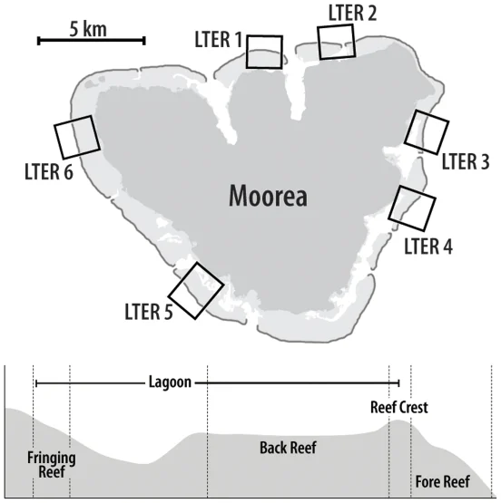

# LTER 4 Temperature Wrangling

Code to build a continuous daily bottom temperature time series for the Moorea Coral Reef (MCR) LTER (Site #4), for a cross-LTER synthesis on pulse dynamics. Pulse metrics require continuous daily data, so this repo picks the most complete forereef record at MCR (LTER 4 10m) and fills its few gaps.

## Site

We use the **LTER 4 forereef thermistor at 10 m**. It has the most complete record of the forereef sensors (99.7% of days from Dec 2006 to Jul 2025), and the forereef matches the area used for the synthesis' MODIS chlorophyll time series. Sites and habitats are shown below (map from Adam et al. 2011, PLOS ONE):

## Workflow

Scripts are in `R/` and should be run in order:

1. `1_summarize_daily_temperatures.Rmd`: reads the raw LTER 4 thermistor file and summarizes it to daily mean, max, and min. Readings are subsampled to one per 20 min so all years are comparable (sampling went from every 20 min to every 1–2 min after 2021), and days with fewer than 20 hours of data are dropped (which could bias daily values).
2. `2_lter4_10m_timeseries.Rmd`: fills gaps in the 10 m series and exports the final time series and figure.
   - The one large gap (16 days, Jul–Aug 2021) is filled with the LTER 4 20 m sensor plus a month-specific offset (10 m minus 20 m) for each metric (mean/min/max).
   - The 6 remaining days (all gaps of 1–2 days) are filled by linear interpolation using the `zoo` package.
   - The `Source` column marks whether each day is measured, filled from 20 m (with a month-specific offset), or interpolated.

The final series runs from 2006-12-10 to 2025-07-08 (6,786 days): 6,765 measured, 15 filled from 20 m, and 6 interpolated.

## Data

Raw data are **not** included in this repo because the files are too large (~400 MB per site). Download the `MCR Bottom-Mounted Thermistor Zip File` from EDI and put the unzipped folder in `raw_data/`:

Moorea Coral Reef LTER, J. Leichter, T. Adam, and H. Krumbholz. 2026. MCR LTER: Coral Reef: Benthic Water Temperature, ongoing since 2005 ver 20. Environmental Data Initiative. https://doi.org/10.6073/pasta/bb8cb2232b3d00e445ece285c1f76f03 (Accessed 2026-11-11).

## Outputs

- `cleaned_data/LTER4_daily_summary_20hr_filter.csv`: daily summaries for all LTER 4 backreef and forereef sensors
- `cleaned_data/lter4_10m_data_gaps.csv`: gaps in the LTER 4 10 m record, in case these need to be reported later
- `cleaned_data/lter4_10m_filled_clean.csv`: **final continuous daily time series** (for the pulse metrics)--this is what should be used to calculate pulse metrics
- `figures/lter4_10m_timeseries.pdf`: plot of the final time series, colored by data source (note very small data gaps)